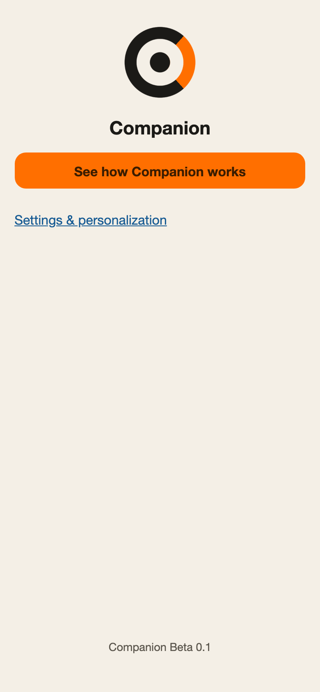
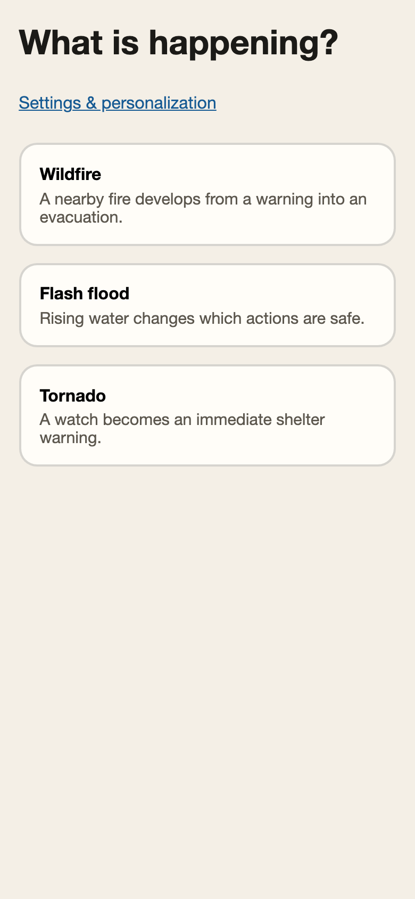
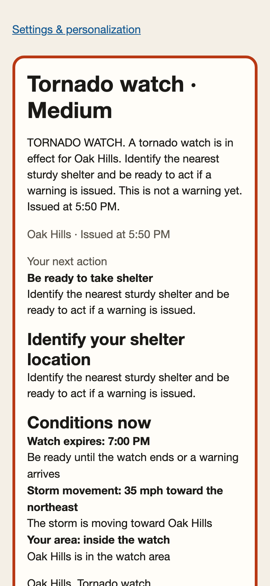

# Companion

Companion is a prototype personal access companion that turns changing emergency information into clear next actions while adapting presentation and support to user-selected needs.

**[Try the live web demo](https://companion-web-ten.vercel.app/)**

This is a documentation-only case study. It intentionally contains no application source, ASL video files, private product-governance material, contact records, or private repository history.

## JT’s role

Jonathan “JT” Thurston led the product direction, accessibility requirements, interaction model, trust and safety boundaries, native/web parity plan, and prototype delivery.

Key product decisions included:

- present one situation, one next action, and one update path instead of a dense alert feed;
- personalize guidance only when a selected need changes what the person should do;
- let people describe support needs directly instead of requiring a diagnosis or disability label;
- keep emergency instructions deterministic while clearly separating unavailable or optional integrations;
- require the user to initiate every call or message handoff; and
- make the native and web demonstrations share scenario, localization, and ASL-mapping fixtures.

## Product walkthrough

  
  
  

The demo follows three scripted emergency flows:

1. **Wildfire** — a nearby fire develops from a warning into an evacuation.
2. **Flash flood** — rising water changes which actions are safe.
3. **Tornado** — a watch becomes an immediate shelter warning.

Each flow moves through staged updates. The screen distinguishes the source alert from Companion’s plain next action, keeps important context visible, and allows the person to review settings without losing their place.

## Supported accessibility features

- User-controlled plain language, one-action-at-a-time, and keep-instructions-visible preferences.
- Larger text, higher contrast, reduced motion, and avoid-flashing preferences.
- Read-aloud controls for important information.
- Recorded ASL presentation for the original alerts in all three demo scenarios.
- English, Spanish, Simplified Chinese, Vietnamese, and Arabic interface content, plus device-language selection.
- Guidance that can account for step-free routes, mobility equipment, transportation, medication and equipment, smoke or oxygen concerns, fatigue or pain, service animals, and responsibility for another person.
- Trusted-contact Add, Edit, and Delete flows with a required relationship; Companion never calls or sends automatically.
- Semantic controls, visible keyboard focus, dialog focus management, and right-to-left layout support.

## Validation approach

The prototype is checked at several levels:

- **Content parity:** generated web content is compared with the native scenario fixtures for all three scenarios, their stages, source alerts, contact rules, and ASL mappings.
- **Settings parity:** automated tests check native section order, fresh-profile defaults, preference-driven guidance, and the exported Companion mark.
- **Localization:** automated checks verify every visible key across the five supported languages.
- **Flow testing:** browser tests cover a complete emergency flow, read-aloud, map, contact rules, and ASL behavior.
- **Responsive review:** the welcome, personalization, picker, and scenario screens are reviewed at iPhone and iPad sizes.
- **Public-content review:** the screenshots in this repository use fictional scenario data and contain no real names, phone numbers, customer information, or saved contacts.

## Current limits

- Companion is a prototype, not an emergency alert service and not a substitute for emergency services or official instructions.
- The three scenarios use scripted, synthetic events; they are not connected to live emergency feeds.
- Locations, times, routes, and map overlays in the demo are illustrative.
- The demo does not place calls or send messages. It only prepares user-initiated system handoffs.
- Aira, Be My Eyes, GoodMaps, HapticNav, on-device intelligence, online interpretation, vibration, and repeated-update reminders are shown as unavailable where applicable; the demo does not present them as working.
- Browser camera sign reading, LED alerts, and native haptics are not offered.

## Repository scope

This repository is intentionally separate from Companion’s private implementation. It contains only this case study and the three reviewed screenshots above.
